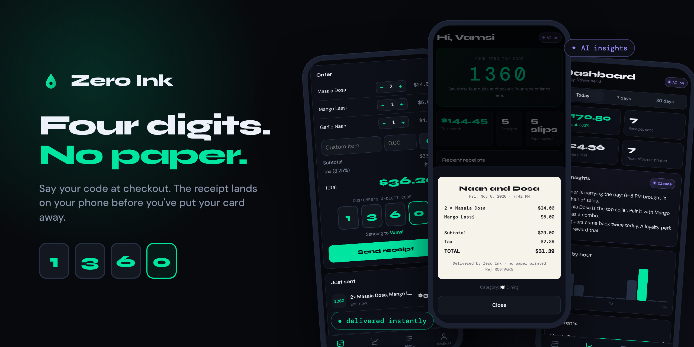
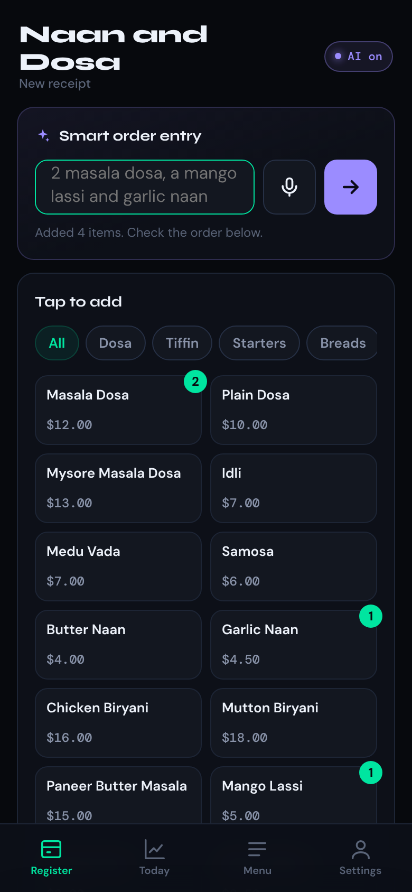
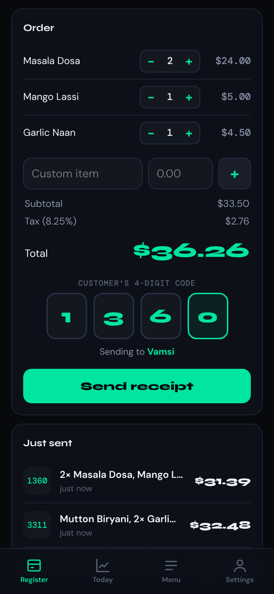
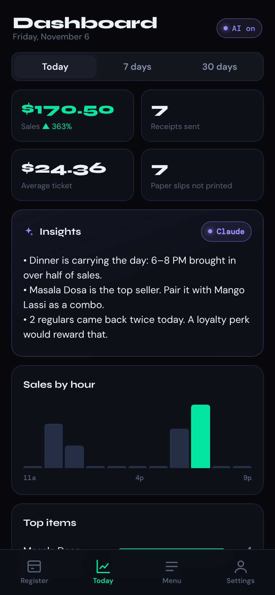
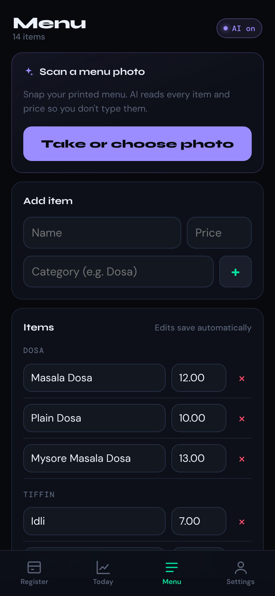
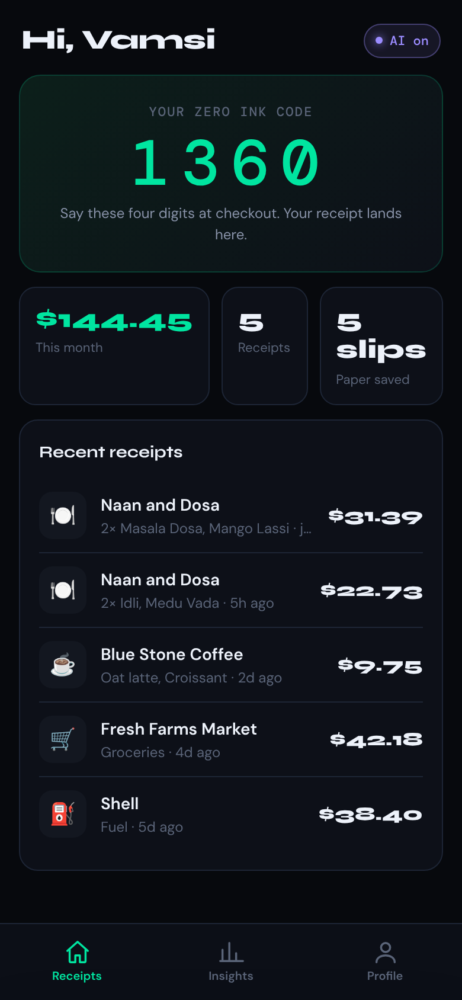
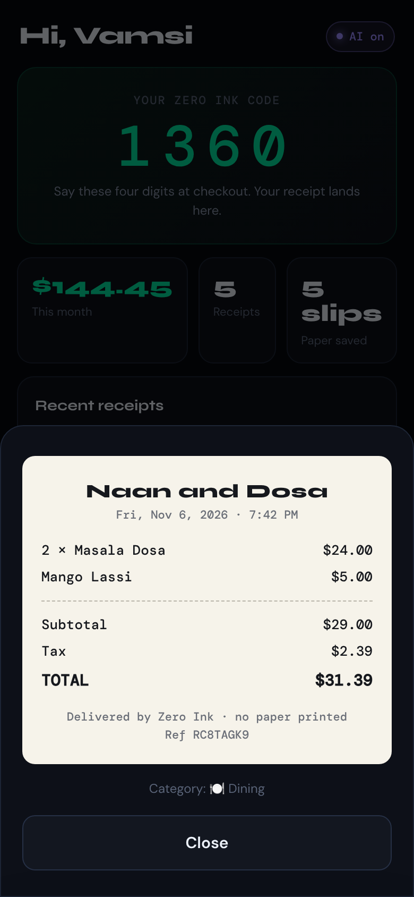
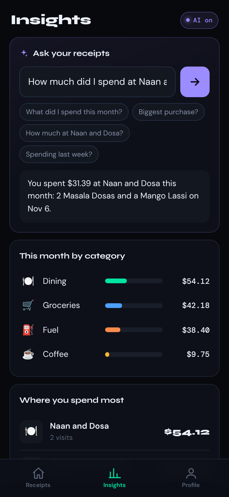
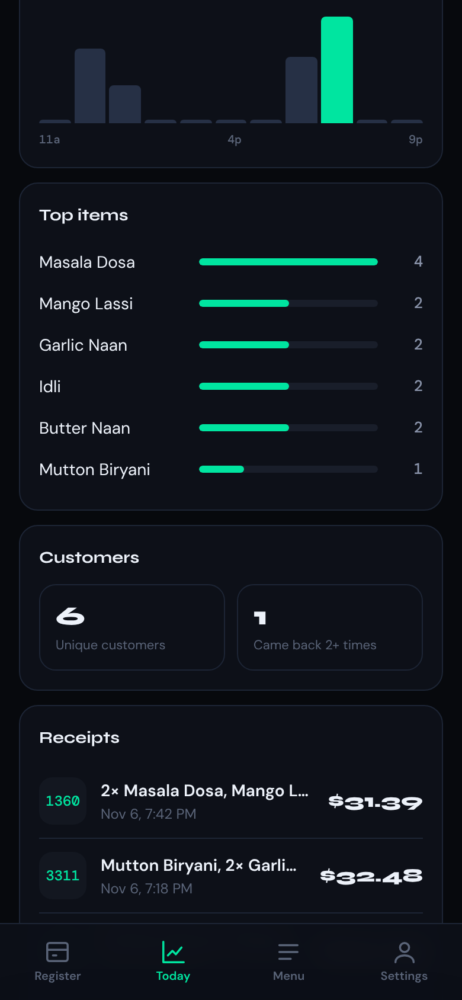
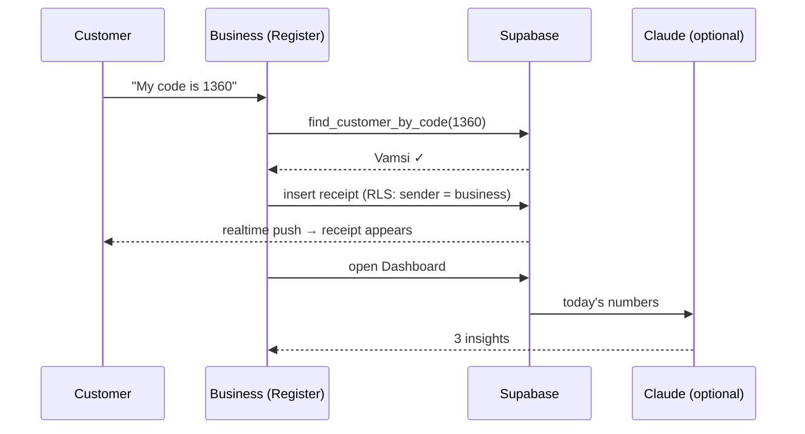

<p align="center">
  
</p>

<p align="center">
  <a href="https://getzeroink.com"></a>
  <a href="https://getzeroink.com/app/"></a>
  
  
  
</p>

<h3 align="center">Paper receipts, minus the paper.</h3>

<p align="center">
At checkout the customer says a 4-digit code. The cashier taps <b>Send</b>.<br>
The itemised receipt is on the customer's phone instantly, with no app to download and nothing to print.
</p>

---

## ✦ Why

Every year US businesses print billions of paper receipts on thermal paper, most of which goes straight in the bin. Paper rolls cost money, run out mid-rush, and the receipt is lost the moment a customer needs it for a return or an expense report.

Zero Ink swaps the receipt printer for four digits:

| | Paper receipt | Email receipt | **Zero Ink** |
|---|---|---|---|
| Customer shares | nothing | full email address, out loud | **4 digits** |
| Arrives | in your hand, then the trash | minutes later, in spam | **instantly, in the app** |
| Business learns | nothing | nothing | **sales, top items, regulars** |
| Paper used | yes | no | **no** |

## ✦ Screens

<table>
  <tr>
    <td align="center" width="25%"><br><b>Smart order entry</b><br><sub>Type or say the order. Typos are fine.</sub></td>
    <td align="center" width="25%"><br><b>Send by code</b><br><sub>Confirms the customer's name before sending</sub></td>
    <td align="center" width="25%"><br><b>Live dashboard</b><br><sub>Sales, tickets, AI insights</sub></td>
    <td align="center" width="25%"><br><b>Menu</b><br><sub>Snap a photo and AI fills in the menu</sub></td>
  </tr>
  <tr>
    <td align="center"><br><b>Your code</b><br><sub>Monthly spend at a glance</sub></td>
    <td align="center"><br><b>The receipt</b><br><sub>Itemised, with tax, saved forever</sub></td>
    <td align="center"><br><b>Ask your receipts</b><br><sub>"How much at Naan and Dosa?"</sub></td>
    <td align="center"><br><b>Hourly and top items</b><br><sub>Know your rush and your best seller</sub></td>
  </tr>
</table>

<sub>Screens shown with sample data.</sub>

## ✦ Features

**For businesses**
- 🎙️ **Voice and smart order entry**: "two masala dosa, a mango lassi and garlic naan" becomes a priced order
- 👆 **Tap-to-add menu grid** with categories, quantities, custom items and sales tax
- 🔢 **Send by 4-digit code**, which shows the customer's first name before you send so the wrong person never gets it
- 📊 **Dashboard** for today, 7 days and 30 days: sales and % change, average ticket, sales by hour, top items, repeat customers
- ✦ **AI insights**: three plain-English takeaways about your day
- 📸 **Menu photo scan**: AI reads a printed menu into items and prices

**For customers**
- ⚡ Receipts arrive **in real time**, with a buzz and a notification card
- 🧾 Full **itemised receipt** view
- 📈 **Spending by category** and top places
- ✦ **Ask your receipts** in plain English

**Works with or without AI.** With a Claude API key the AI features use Claude. Without one, the app switches to *Smart mode*: built-in, tested rules for order parsing, answers and insights. Nothing breaks.

## ✦ How it works



| Layer | Tech |
|---|---|
| App | HTML, CSS, JavaScript ES modules. No framework, no build step, installable to the home screen |
| Hosting | GitHub Pages + custom domain |
| Data | Supabase Postgres with Row Level Security |
| Auth | Supabase Auth (email + password) |
| Live delivery | Supabase Realtime |
| AI | Supabase Edge Function → Claude |

## ✦ Project layout

```
index.html                     Landing page (getzeroink.com)
app/
  index.html                   App shell
  css/app.css                  Styles
  js/
    main.js                    Entry point
    config.js                  Supabase URL + publishable key
    state.js                   Shared app state
    auth.js                    Sign in / sign up / profile + code creation
    shell.js                   Navigation, routing, realtime delivery
    lib/
      parser.js                Order parser (typos, plurals, "x2", "two")
      answer.js                "Ask your receipts" rules
      stats.js                 Dashboard math + insights
      ai.js                    Client for the AI edge function
      actions.js               Event delegation (data-action="…")
      categories.js · supabase.js · storage.js · utils.js
    screens/
      merchant/register.js     Smart entry, menu grid, send
      merchant/dashboard.js    Sales, hours, items, customers
      merchant/menu.js         Menu editor + photo scan
      customer/home.js         Code, totals, receipts, receipt slip
      customer/insights.js     Ask, categories, top places
      settings.js              Profile / business settings
supabase/
  migrations/                  Database schema, in order
  functions/ai/index.ts        AI edge function
  seed/                        Demo menu
tests/                         Unit tests (node --test)
docs/                          Banner + screenshots
```

## ✦ Run it locally

Requires Node 20+.

```bash
npm run dev     # http://localhost:5173/app/
npm test        # parser, answers and dashboard math
```

## ✦ Deploy

| What | How |
|---|---|
| App + landing page | Push to `main`. GitHub Pages is live in about a minute |
| Database | Apply `supabase/migrations/` in order (`npm run db:push`). Run `…_lock_profiles.sql` only after v2 is live |
| AI function | `npm run deploy:function` |
| Turn AI on | Supabase → Edge Functions → Secrets → `ANTHROPIC_API_KEY` |

## ✦ Privacy and security

| Data | Who can read | Who can write |
|---|---|---|
| Receipts | the customer it was sent to, and the business that sent it | a signed-in business, as itself |
| Menus | the owning business | the owning business |
| Profiles | the user themselves | the user themselves |
| Code lookup | `find_customer_by_code()` returns only an id and first name | n/a |

The publishable key in `config.js` is meant to be public. Row Level Security limits it to the rules above.

## ✦ Status

Getting ready for a first restaurant pilot. Interested in trying Zero Ink at your counter? **hello@getzeroink.com**

<p align="center"><sub>© 2026 Zero Ink</sub></p>
